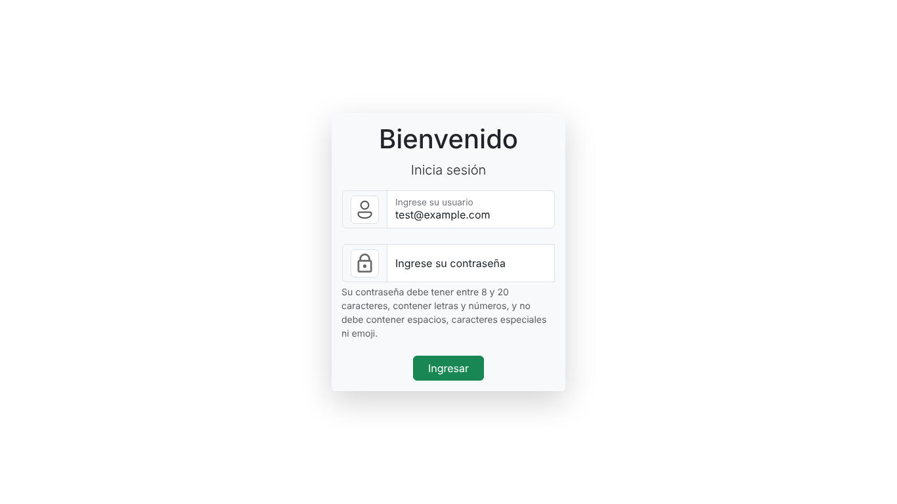

# Login


[](https://andrestorresaioros.github.io/Login/)

Maqueta de una pantalla de inicio de sesión construida con HTML, CSS, JavaScript y Bootstrap 5.3.

**Demo:** https://andrestorresaioros.github.io/Login/

## Vista previa



## Características

- Formulario con campos de usuario y contraseña acompañados de iconografía.
- Texto de ayuda con la política de contraseñas (entre 8 y 20 caracteres, letras y números, sin espacios ni caracteres especiales).
- Interacción básica con JavaScript: al enviar, el título cambia para confirmar que la información se guardó.
- Tarjeta centrada con sombra, campos flotantes de Bootstrap y estilos propios en `styles.css`.

## Estructura

```
.
├── index.html     # Estructura de la pantalla
├── styles.css     # Estilos
├── login.js       # Interacción del formulario
└── imagenes/      # Iconos y favicon
```

## Ejecución local

No requiere instalación. Abre `index.html` en el navegador o sirve la carpeta:

```bash
python -m http.server 8000
```

y visita `http://localhost:8000`.

## Autor

**César Andrés Torres Bernal** · [GitHub](https://github.com/andrestorresaioros) · [LinkedIn](https://www.linkedin.com/in/andr%C3%A9s-torres10)

## Licencia

Distribuido bajo la licencia MIT. Consulta [LICENSE](LICENSE).
